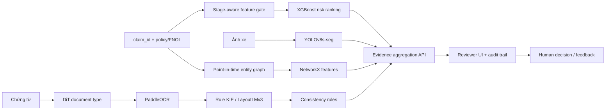

# Data Card, Model Card và Kiến trúc hệ thống — v2

**Ngày cập nhật:** 12/10/2026  
**Phạm vi tuyên bố:** PoC nghiên cứu và hệ thống hỗ trợ reviewer; chưa production-ready.

## 1. Data Card

### Layer B tabular

- Bronze: 1.000 dòng × 39 cột nguồn.
- Silver: 1.000 dòng × 42 cột, bổ sung `claim_id`, `source_row`, `fraud_label`.
- Gold v2: train 700, validation 100, test 200.
- Target quan sát: 247 `Y` (24,7%) và 753 `N` (75,3%).
- Missing đã đo: `property_damage` 36,0%; `police_report_available` 34,3%; `collision_type` 17,8%; `authorities_contacted` 9,1%. Các cột còn lại 0% missing trong bản Silver hiện tại.
- Placeholder `?` đã chuyển thành null; imputation/encoding chỉ fit trong training pipeline.
- Bảng governance 39 trường nằm tại `LAYER_B_STAGE_RELIABILITY_DICTIONARY_V1.md` và `configs/layer_b_field_governance_v1.csv`.

Các rủi ro chưa đóng: provenance của `fraud_reported`, stage availability của trường confidence thấp, proxy/fairness và khác biệt prevalence với production. Xem `FRAUD_LABEL_PROVENANCE_V1.md`.

### Dữ liệu ảnh CarDD

- Train 1.966 ảnh/4.345 instances; validation 431/935; test 419/931.
- Exact validation và final-test protocol đã khóa; final test chạy đúng một lần.
- Public data phù hợp benchmark tổn thất, chưa thay cho ảnh claim thật có `claim_id` và consent/license đầy đủ.

### Dữ liệu chứng từ

- CORD v2, FUNSD, XFUND, SROIE và RVL-CDIP sample đã intake/audit; MIDV còn giới hạn theo scope/license/storage.
- SROIE raw có tám ảnh trùng train/test. Processed split đã sửa thành 525 train, 93 validation, 361 test; cross-split exact duplicate bằng 0.
- Public document datasets không được ghép theo từng dòng với Layer B hoặc CarDD để tạo claim giả.

## 2. Model Card tổng hợp

| Module | Phiên bản/trạng thái | Validation/test evidence | Giới hạn chính |
|---|---|---|---|
| Tabular risk | XGBoost v1 + sigmoid calibration | AP 0,559; ROC-AUC 0,825; Recall@10% 22,4%; Precision@10% 55,0% trên frozen test 200 | KPI +10 điểm Recall@10% chưa đạt; test đã tái sử dụng cho sensitivity; label provenance thấp |
| Damage segmentation | YOLOv8s-seg candidate đã chọn | Validation mask mAP50-95 0,5284; final test 0,5140 trên 419 ảnh | `crack`, `dent`, `scratch` còn yếu; domain public |
| Document classifier | DiT pretrained baseline | Independent macro-F1 0,9283; balanced accuracy 0,9281 trên 320 ảnh RVL validation | Chưa phải bảo hiểm/Vietnamese-domain validation |
| OCR | PaddleOCR | CER 0,4097; WER 0,5592; 28,17 giây/trang trên 93 SROIE validation | Chất lượng và tốc độ chưa đạt production |
| KIE baseline | Rule KIE v1 | date/total micro-F1 0,6776 | Recall thấp |
| KIE candidate | LayoutLMv3 v3 | Validation field micro-F1 0,9214; rule baseline 0,6834; coverage 0,9892 | Được chọn theo rule khóa trước; SROIE test vẫn khóa; mới có `date`/`total` |
| Consistency | Versioned rules | Synthetic demo PASS | Chưa benchmark trên claim-document thật |
| Relationship | NetworkX features | Point-in-time synthetic demo PASS | Không phải fraud model; chưa có graph nghiệp vụ thật |

### KPI tabular

Rule baseline Recall@10% là 16,3%; XGBoost đạt 22,4%, tăng 6,1 điểm phần trăm. Mục tiêu tăng tối thiểu 10 điểm chưa đạt, thiếu 3,9 điểm. Với prevalence 24,7%, trần lý thuyết Recall@10% của queue 10% xấp xỉ 40,5%; không dùng mục tiêu tuyệt đối 60% cho dataset này.

### Intended use

Các model tạo tín hiệu và bằng chứng để reviewer/SIU ưu tiên kiểm tra. Chúng không xác nhận hành vi gian lận, không tự từ chối bồi thường và không thay thế điều tra nghiệp vụ.

## 3. Kiến trúc hệ thống

### Quy tắc hợp nhất

- Chỉ hợp nhất dữ liệu có `claim_id` thật và lineage hợp lệ.
- Field/model chỉ được dùng nếu đã tồn tại tại scoring timestamp.
- Output phải kèm model version, checkpoint hash, evidence reference, confidence và trace ID.
- Missing/low-confidence trả `unknown`, không tự suy diễn thành `pass` hoặc `fraud`.

## 4. Trạng thái sản phẩm

Đã có source code cho document pipeline, consistency, graph feature và reviewer contract; CarDD checkpoint đã khóa. Chưa có API/UI tích hợp, claim-level dataset thật, security/privacy test, monitoring, UAT hoặc external validation. Trạng thái đúng là **research prototype có module-level evidence**, chưa phải hệ thống go-live.

## 5. Bước tiếp theo

1. Giữ checkpoint LayoutLMv3 đã chọn, chưa mở SROIE test; bổ sung error analysis cho hai total OCR không align.
2. Dùng independent DiT macro-F1 0,9283 làm metric chính; giữ smoke 0,9626 chỉ như lịch sử kỹ thuật.
3. Tạo golden claim set thật có ảnh, chứng từ, field truth, timestamp và reviewer outcome.
4. Tích hợp API/UI theo `claim_id`, chạy end-to-end test và UAT human-in-the-loop.
5. Chỉ pilot sau legal/PII/license review, label contract, monitoring và rollback plan.

