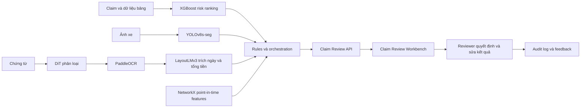

# Product handoff và kế hoạch nâng chất lượng — 13/10/2026

## 1. Nhóm đang làm sản phẩm gì?

Sản phẩm là **Claim Review Workbench**: màn hình làm việc cho nhân viên tiếp nhận, giám định viên và bộ phận kiểm tra đặc biệt. Người dùng mở một `claim_id`, xem hồ sơ, ảnh hư hỏng, chứng từ, quan hệ đáng chú ý và các lý do hệ thống đề nghị ưu tiên kiểm tra. Mọi quyết định cuối cùng vẫn do con người thực hiện.

Ba ý tưởng UI trước đây được gộp thành một sản phẩm:

- **Operations Workbench** là màn hình chính để xử lý claim.
- **Evidence Ledger** là tab bằng chứng, nguồn dữ liệu, phiên bản model và audit trail.
- **Triage Map** là tab quan hệ giữa claim, khách hàng, xe, số điện thoại, tài khoản và đơn vị sửa chữa.

Đội UI không cần mở notebook hoặc tải checkpoint. Họ gọi API của nhóm model và nhận JSON có schema cố định. Trong lúc model live chưa sẵn sàng, API trả fixture JSON có cùng schema để đội UI triển khai song song.

## 2. Hệ thống hoạt động như thế nào?



Đây là hệ thống nhiều module. `XGBoost` xếp hạng hồ sơ từ dữ liệu bảng; `YOLOv8s-seg` tìm vùng hư hỏng; `DiT → PaddleOCR → LayoutLMv3` xử lý chứng từ; rules so sánh dữ liệu; `NetworkX` tạo tín hiệu quan hệ. API hợp nhất chúng bằng `claim_id` và trả về evidence, confidence, model version, trace ID và cảnh báo.

## 3. Trạng thái model hiện tại

| Module | Công nghệ | Kết quả đáng dùng để báo cáo | Trạng thái |
|---|---|---:|---|
| Risk ranking | XGBoost | Test AP 0,559; Recall@10% 22,4% | Baseline nghiên cứu, chưa đạt KPI |
| Damage segmentation | YOLOv8s-seg | Final-test mask mAP50-95 0,5140 | Final test hoàn tất; yếu ở crack/dent/scratch |
| Document classification | DiT | Independent macro-F1 0,9283 | Research validation hoàn tất |
| OCR | PaddleOCR | CER 0,4097; WER 0,5592 | Baseline còn yếu và chậm |
| KIE | LayoutLMv3 | Final-test field micro-F1 0,8659; Date F1 0,8320; Total F1 0,8995 | Final test 361 ảnh hoàn tất |
| Consistency | Python rules | Demo PASS | Cần claim thật và rule nghiệp vụ |
| Relationship | NetworkX | Point-in-time demo PASS | Cần entity/edge thật có timestamp |

Metric cross-validation của XGBoost (`AP 0,706`, `Recall@10% 30,3%`) chỉ dùng để mô tả quá trình chọn model. Khi nói về khả năng tổng quát hóa hiện tại, dùng kết quả frozen test (`AP 0,559`, `Recall@10% 22,4%`).

## 4. Vì sao Recall@10% ≥ 60% không đạt được trên dataset hiện tại?

Dataset có 24,7% hồ sơ mang nhãn `Y`. Nếu chỉ xem 10% tổng số hồ sơ thì ngay cả xếp hạng hoàn hảo cũng chỉ chứa tối đa:

`Recall tối đa = min(100%, K / prevalence) = 10% / 24,7% = 40,5%`.

Vì vậy 60% là **bất khả thi về mặt toán học trên cohort này tại K=10%**. Đây không phải lỗi riêng của XGBoost. Muốn đạt Recall 60%, ít nhất một điều kiện phải thay đổi:

| Phương án | Điều kiện để 60% khả thi | Ý nghĩa nghiệp vụ |
|---|---:|---|
| Giữ prevalence 24,7% | `K ≥ 14,82%` | Cho reviewer xem ít nhất khoảng 15% hồ sơ |
| Giữ K=10% | `prevalence ≤ 16,67%` | Đánh giá trên dòng hồ sơ thực tế có tỷ lệ fraud thấp hơn |
| Cascade hai tầng | Tầng đầu tạo cohort phù hợp, tầng hai xếp hạng | Phải báo cáo rõ mẫu số Recall và tải review thực tế |
| Thay KPI | Relative uplift, Recall@capacity hoặc Precision@K | KPI gắn với ngân sách review và prevalence thật |

Không được hạ prevalence bằng cách xóa tùy ý hồ sơ dương/âm. Cần đo trên dữ liệu vận hành đại diện. Nếu production prevalence thực sự 5–10%, Recall@10% ≥ 60% có thể khả thi về trần toán học, nhưng vẫn cần external validation để chứng minh.

## 5. Kế hoạch nâng XGBoost đúng cách

1. **Đóng lại protocol:** test 200 dòng cũ đã được dùng; mọi thử nghiệm tiếp theo chỉ chạy trên `train_fs`/`val_fs`. Chỉ đánh giá cuối trên external test mới.
2. **Xác minh nhãn:** coi `fraud_reported` là observed status, lập quy trình adjudication và thời gian trưởng thành nhãn. Tách hồ sơ chưa điều tra khỏi confirmed non-fraud nếu có dữ liệu thật.
3. **Xác minh thời điểm feature:** chỉ dùng trường có sẵn tại checkpoint chấm điểm. Xóa identifier, target leakage và proxy không có cơ sở nghiệp vụ.
4. **Thêm S1–S5 có `claim_id`:** tín hiệu ảnh, chứng từ, consistency, lịch sử và graph phải đến từ cùng claim thật; không ghép các public dataset theo hàng.
5. **Tối ưu trực tiếp cho hàng đợi:** theo dõi AP và Recall@capacity trên validation. Class weight chỉ là tham số thử nghiệm, không mặc định làm Recall@10 tốt hơn.
6. **So sánh có kiểm soát:** Logistic Regression, XGBoost hiện tại, XGBoost + feature hợp lệ, và cascade. Chỉ giữ thay đổi vượt ngưỡng đã đặt trước và ổn định qua bootstrap/fold.
7. **Hiệu chuẩn theo prevalence thật:** calibration và threshold/capacity được fit trên validation đại diện; không gọi raw score là xác suất khi chưa hiệu chuẩn.
8. **Error analysis:** chia false negative theo loại sự cố, mức tiền, stage, mức đầy đủ chứng từ và nhóm nhạy cảm. Cải thiện nguyên nhân cụ thể rồi mới train lại.

Mốc hợp lý trước mắt là vượt rule baseline ít nhất 10 điểm phần trăm Recall@10 trên validation mới, giữ AP tốt hơn Logistic Regression, và không làm xấu fairness/stability. KPI 60% chỉ được kích hoạt khi cohort và review capacity làm nó khả thi.

## 6. Cách người khác dùng và nhận bàn giao

### Cách khuyến nghị: gọi API

Đội UI hoặc hệ thống claim gọi:

```http
POST /claims/CLM-2026-000123/analyze
Content-Type: application/json

{"claim_amount":16000000,"incident_date":"2026-10-11","plate_number":"51H-123.42"}
```

Sau đó đọc kết quả bằng `GET /claims/{claim_id}/analysis` và ghi quyết định reviewer bằng `POST /claims/{claim_id}/review`. Swagger UI nằm tại `/docs`; OpenAPI contract nằm trong `contracts/claim_review_openapi.v1.json`.

### Chạy local cho đội prototype

```powershell
python -m venv .venv
.\.venv\Scripts\python.exe -m pip install -r requirements-api.txt
.\.venv\Scripts\python.exe -m uvicorn src.api.app:app --reload
```

Mở `http://127.0.0.1:8000/` để xem UI và `http://127.0.0.1:8000/docs` để thử API. Bản hiện tại chạy `fixture` mode nhằm khóa contract trước khi nối checkpoint thật.

### Chạy bằng Docker

```bash
docker build -f Dockerfile.api -t claim-review-api:research-v1 .
docker run --rm -p 8000:8000 claim-review-api:research-v1
```

### Bộ bàn giao tối thiểu

- source code và commit/tag;
- OpenAPI contract và JSON fixture;
- model registry gồm version, metric, trạng thái gate và artifact hash;
- container/API image;
- checkpoint trong kho artifact có quyền truy cập, không gửi qua Git;
- model/data card, giới hạn sử dụng và hướng dẫn rollback;
- golden claims, expected output và test report;
- audit log schema, owner và quy trình xử lý lỗi.

Chỉ ML team cần nhận checkpoint trực tiếp. Đội UI, QA và hệ thống nghiệp vụ nên tích hợp qua API để model có thể nâng cấp mà không đổi giao diện.

## 7. Các gate còn lại trước khi pilot

1. LayoutLMv3 final test và registry đã hoàn tất; giữ nguyên checkpoint và không tối ưu theo test.
2. Viết live adapters cho từng model phía sau API contract hiện tại.
3. Tạo golden claims có `claim_id` xuyên suốt ảnh, chứng từ, tabular và graph.
4. Chạy integration, security, privacy, latency/load test và UAT.
5. Domain validation trên hồ sơ bảo hiểm Việt Nam có consent và ground truth.
6. Pilot có human review, monitoring, rollback và không tự động từ chối claim.

## 8. Câu trả lời ngắn để trình bày

“Nhóm xây Claim Review Workbench, không phải một model duy nhất. Các model phân tích dữ liệu bảng, ảnh, chứng từ và quan hệ; API hợp nhất kết quả theo claim_id để nhân viên xem bằng chứng và quyết định. Recall@10% 60% không thể đạt trên bộ hiện tại vì tỷ lệ Y là 24,7%, làm trần toán học chỉ 40,5%. Nhóm sẽ xác lập KPI theo prevalence và capacity thật, bổ sung tín hiệu S1–S5 có linkage thật, đánh giá trên validation mới và external test, rồi bàn giao dưới dạng API có version, registry, audit trail và golden tests.”
