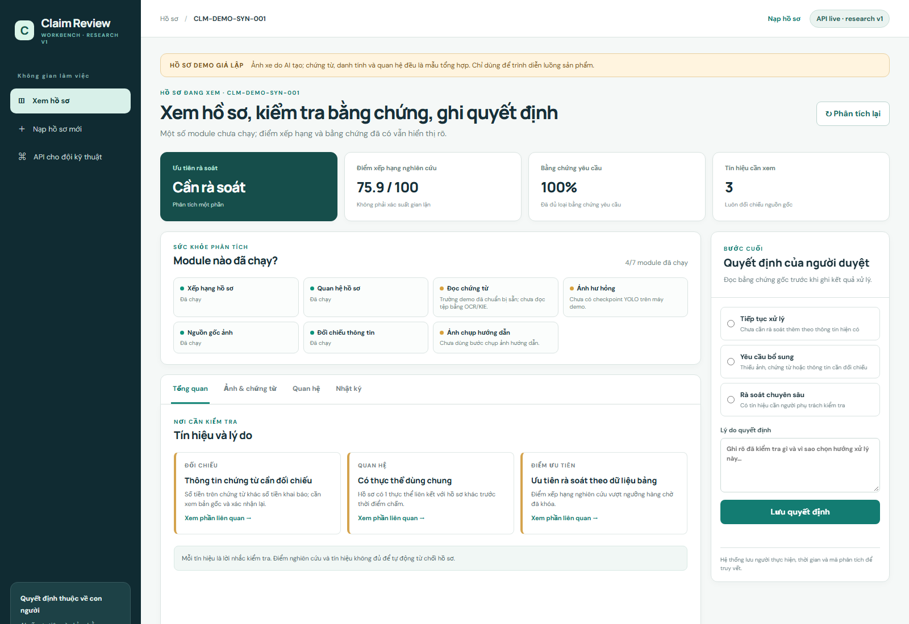
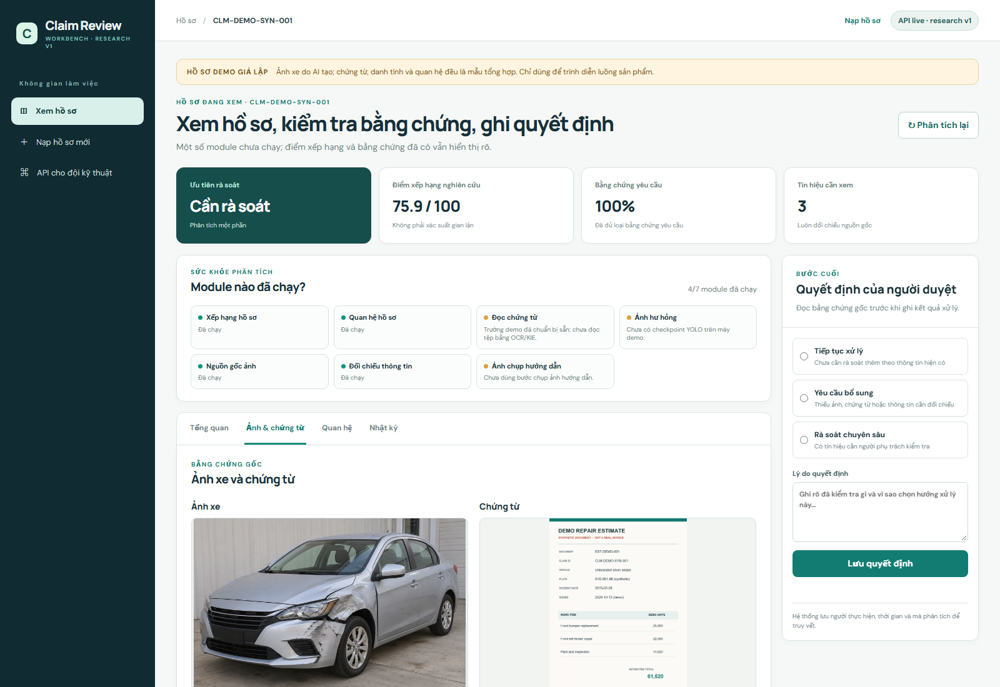

# Báo cáo tiến độ lần 2 — Data, mô hình và sản phẩm demo

**Cập nhật:** 13/10/2026 · **Sản phẩm:** Claim Review Workbench · **Mốc hiện tại:** nền kỹ thuật đã chạy, bàn giao nghiên cứu đa phương thức chưa hoàn tất.

## 00. Đọc nhanh trong một phút

Nhóm đã kiểm toán dữ liệu, huấn luyện hoặc đánh giá các mô hình riêng cho dữ liệu bảng, ảnh xe và chứng từ. XGBoost đã được đóng gói và chạy thật trong API cùng quy tắc đối chiếu, NetworkX và kiểm tra nguồn gốc ảnh. Giao diện mới cho người duyệt mở một claim, xem điểm ưu tiên, ảnh, chứng từ, tín hiệu, quan hệ, rồi ghi quyết định và chỉnh sửa có nhật ký.

**Demo đang chạy trên máy local:** `CLM-DEMO-SYN-001` có cùng một `claim_id` cho dữ liệu bảng, ảnh xe do AI tạo, chứng từ giả lập và graph. API trả điểm xếp hạng nghiên cứu **75,9/100**, trạng thái **partial**, ba tín hiệu cần xem và một thực thể dùng chung. Ảnh được phân tích metadata tự động nhưng kết luận nguồn gốc là **inconclusive**. Trường chứng từ trong demo được chuẩn bị sẵn để chạy consistency; OCR/KIE chưa đọc tệp này. YOLO và LayoutLMv3 chưa chạy trên máy demo vì còn thiếu checkpoint cục bộ.

**Không dùng demo để báo cáo độ chính xác model.** Ảnh/chứng từ tổng hợp chỉ kiểm tra luồng sản phẩm. Các chỉ số nghiên cứu bên dưới đến từ tập đánh giá riêng đã khóa.

## 01. Sản phẩm này dùng để làm gì?

Giám định viên nhận một hồ sơ bồi thường xe, xem hồ sơ nào cần ưu tiên, mở từng bằng chứng, đối chiếu điểm sai lệch và lưu quyết định. AI hỗ trợ người duyệt tập trung vào đúng chỗ cần xem. Hệ thống **không tự kết luận gian lận hoặc tự từ chối hồ sơ**.

Luồng sử dụng hiện tại:

1. Mở hoặc nạp claim cùng thông tin khai báo, ảnh và chứng từ.
2. Bấm phân tích một lần. Các module có đầu vào và artifact hợp lệ tự chạy; module thiếu được ghi rõ.
3. Xem mức ưu tiên, điểm xếp hạng, tín hiệu, ảnh/chứng từ gốc, quan hệ và nguồn gốc ảnh.
4. Sửa trường chứng từ nếu đọc sai; chọn tiếp tục xử lý, yêu cầu bổ sung hoặc rà soát chuyên sâu.
5. Lưu lý do. Nhật ký ghi người thao tác, thời gian, `claim_id` và `trace_id`.

Nếu không có ảnh, chứng từ hoặc graph, hệ thống vẫn trả điểm XGBoost khi dữ liệu bảng đủ trường, đồng thời gắn `partial`. Nếu thiếu trường bảng bắt buộc, điểm bị chặn và không được bịa ra.

## 02. Đối chiếu yêu cầu báo cáo tiến độ 2

| Yêu cầu của môn học | Bằng chứng đã có | Trạng thái |
| --- | --- | --- |
| Data Audit Report | Kiểm file thật, checksum, cấu trúc, duplicate, leakage; báo cáo nguồn chứng từ và Layer B | Có |
| Data Dictionary / Knowledge Base Audit | 39 cột Layer B: nghĩa, nguồn, thời điểm có sẵn, độ tin cậy và chính sách dùng | Có; các trường (?) chờ xác nhận nghiệp vụ |
| EDA / phân tích tài liệu nguồn | Tabular, CarDD, SROIE, CORD, FUNSD, XFUND, RVL-CDIP, MIDV | Có |
| Ground Truth Definition / Citation Policy | Định nghĩa nhãn cho fraud, ảnh và chứng từ; RAG chưa chọn | Có; RAG N/A |
| Data Leakage Check | SROIE raw train/test trùng ảnh; FUNSD cây lưu trữ trùng; tabular test đã dùng lại | Có, giới hạn được ghi rõ |
| Baseline model / process | Logistic/rule cho tabular; YOLOv8n; DiT; PaddleOCR; rule KIE | Có |
| Model Selection Matrix | Quy tắc chọn XGBoost, YOLOv8s và LayoutLMv3 theo validation | Có |
| Metrics v1 | CV, frozen test, mAP, macro-F1, CER/WER, field-F1 | Có |
| Risk Register v2 | Nhãn, license, PII, bias, miền dữ liệu, bảo mật, latency | Có |

## 03. Dữ liệu: nhóm đã tìm và sửa vấn đề gì?

- **SROIE:** mirror raw có tám ảnh trùng tuyệt đối giữa train/test. Nhóm giữ test 361 ảnh, loại tám ảnh train trùng, chia lại phần train theo nhóm SHA-256 thành 525 train và 93 validation. Kiểm tra exact overlap giữa ba split bằng 0.
- **FUNSD:** lần đếm đầu cho 398 vì hai cây lưu trữ trùng. Canonical dataset là 199 ảnh và 199 annotation; ảnh canonical đọc được.
- **XFUND:** 28 asset được audit, checksum/ZIP không lỗi, không có ảnh trùng tuyệt đối giữa train/validation.
- **RVL-CDIP:** 1.600 ảnh mẫu, cân bằng 100 ảnh cho mỗi 16 lớp, đã audit. Tập này có thể trùng với dữ liệu upstream của DiT nên không dùng kết quả smoke làm validation độc lập.
- **Layer B:** 1.000 hồ sơ, 247 nhãn Y. Một số trường chỉ có sau giám định hoặc đủ chứng từ; nhãn `fraud_reported` chỉ là **observed fraud status**, chưa chứng minh Y/N là gian lận hoặc không gian lận đã được xác minh.

Những điểm này quan trọng vì đếm sai, split trùng hoặc dùng trường có sau quyết định đều có thể làm metric đẹp giả.

## 04. Model nào, hiệu quả ra sao?

| Bộ phận | Công nghệ | Kết quả đã đo | Giới hạn cần nói rõ |
| --- | --- | --- | --- |
| Xếp hạng hồ sơ | XGBoost; Logistic Regression làm baseline | CV AP 0,706; CV Recall@10% 30,3%. Frozen test AP 0,559; Recall@10% 22,4% | Chưa đạt KPI đề xuất; nhãn nguồn chưa xác minh; test tabular đã dùng lại cho sensitivity |
| Ảnh hư hỏng | YOLOv8s-seg; YOLOv8n-seg baseline | Final test mask mAP50-95 0,5140 trên 419 ảnh | `crack`, `dent`, `scratch` yếu; chưa kiểm trên ảnh bảo hiểm Việt Nam |
| Phân loại chứng từ | Microsoft DiT | Validation độc lập macro-F1 0,9283 trên 320 ảnh | Chưa phải document mix bảo hiểm Việt Nam |
| Đọc chữ | PaddleOCR | 93 trang validation: CER 0,4097; WER 0,5592; 28,17 giây/trang | Sai nhiều và chậm; cần error analysis có kiểm soát |
| Trích xuất ngày/tổng tiền | LayoutLMv3; rule KIE baseline | Validation field F1 0,9214; final test 361 ảnh: 0,8659 | Chỉ hai field trên receipt SROIE; test đã khóa, không dùng để chỉnh tiếp |
| Đối chiếu | Python rules | Demo engineering PASS | Cần xác nhận chính sách nghiệp vụ và đơn vị tiền/ngày |
| Quan hệ | NetworkX theo thời điểm | Demo engineering PASS | Chưa có graph thật để đo fraud lift |
| Nguồn gốc ảnh | Metadata, C2PA nếu có tool, hash/perceptual hash | Luồng tự chạy khi upload; ảnh demo cho kết quả `inconclusive` | Không có marker không chứng minh ảnh thật; chưa có pixel forensic model đã benchmark |

**Về KPI 60%:** trên toàn bộ nguồn 1.000 hồ sơ với 247 Y, chỉ được duyệt 100 hồ sơ thì ngay cả xếp hạng hoàn hảo cũng thu hồi tối đa `100/247 = 40,5%`. Với frozen test 200 hồ sơ và 49 Y, trần tương ứng là `20/49 = 40,8%`. Vì vậy KPI Recall@10% ≥ 60% cần được định nghĩa lại theo prevalence, review capacity và dữ liệu vận hành thật; không thể đạt bằng cách train thêm trên cùng phép chia này.

**Quy tắc đánh giá:** XGBoost được chọn vì tốt nhất trong bốn ứng viên đã thử, nhưng lợi thế CV AP so với Logistic Regression chỉ 0,035; chưa có so sánh uncertainty theo cặp. Kết quả frozen test thấp hơn CV. Chưa có cơ sở gọi model là production ready.

## 05. Trạng thái kỹ thuật đã kiểm ngày 13/10/2026

| Thành phần | Trạng thái trên máy local |
| --- | --- |
| API, OpenAPI contract và UI live | Chạy được; giao diện đọc response từ FastAPI |
| XGBoost bundle và hash | PASS; inference thật |
| Consistency, NetworkX, authenticity metadata | PASS trong demo tích hợp |
| 5 golden claims dữ liệu bảng/field/graph | 5/5 qua API; đây là test orchestration, ảnh chỉ là manifest |
| 1 claim demo ảnh + chứng từ nhị phân | Chạy qua API; ảnh và chứng từ hiển thị trong UI |
| YOLO checkpoint `best.pt` | Chưa có trên máy này; adapter và dependency đã sẵn sàng |
| LayoutLMv3 `checkpoint-264` | Chưa có trên máy này; adapter và dependency đã sẵn sàng |
| PDF/ảnh chứng từ đọc bằng OCR/KIE live | Chưa chứng minh trên claim demo vì thiếu checkpoint |
| Review/correction audit | Có API lưu và API đọc lại sự kiện trong local runtime |
| Full test suite | 103 passed, 1 skipped |
| Definition of Done `engineering_foundation` | PASS |
| Definition of Done `research_handoff` | CHƯA PASS: thiếu hai checkpoint và ba xác nhận bàn giao |

Giao diện hiển thị “trường demo đã chuẩn bị sẵn” khi dùng precomputed fields. Điều này giúp người xem không nhầm kết quả consistency với kết quả OCR/KIE của chứng từ giả.

## 06. Cách demo cho team trong 5 phút

**Chuẩn bị:** trong thư mục repo, chạy `powershell -ExecutionPolicy Bypass -File scripts/setup_live.ps1`, tiếp theo `.\.venv\Scripts\python.exe scripts/seed_synthetic_demo.py`, rồi `powershell -ExecutionPolicy Bypass -File scripts/run_live.ps1`. Mở `http://127.0.0.1:8000/?claim_id=CLM-DEMO-SYN-001`.

1. Chỉ banner “Hồ sơ demo giả lập”; giải thích ảnh xe được AI tạo, chứng từ/quan hệ là mẫu tổng hợp.
2. Chỉ điểm 75,9/100 và nhắc đó là **điểm xếp hạng nghiên cứu**, không phải 75,9% xác suất gian lận.
3. Chỉ `partial` và danh sách module: YOLO chưa bật; trường chứng từ chuẩn bị sẵn; authenticity chạy nhưng `inconclusive`.
4. Mở tab **Ảnh & chứng từ**: xem vết hư hỏng trên ảnh gốc và chứng từ giả có watermark. Không giới thiệu mask YOLO hoặc OCR box nếu chúng chưa xuất hiện.
5. Mở tab **Quan hệ**: một shared entity theo thời điểm. Mở **Nhật ký** sau khi lưu một quyết định hoặc correction để thấy truy vết.

Đường dẫn trực tiếp: `http://127.0.0.1:8000/?claim_id=CLM-DEMO-SYN-001&tab=evidence`. Ảnh/chứng từ demo nằm tại `prototype/demo_assets/`; script nạp là `scripts/seed_synthetic_demo.py`. API docs dành cho dev: `/docs`.

Ảnh chụp màn hình giao diện thật khi mở hồ sơ demo:

**Câu trình bày ngắn:** “Nhóm đã hoàn thành Data Audit, Baseline và Evaluation v1. Prototype dùng XGBoost thật để xếp hạng hồ sơ, kết hợp kiểm tra chứng từ, quan hệ và nguồn gốc ảnh trên cùng một `claim_id`. Demo hiện là `partial` vì máy trình diễn chưa có hai checkpoint lớn. Người duyệt vẫn xem bằng chứng và ghi quyết định; pilot thực tế cần dữ liệu bảo hiểm Việt Nam, bảo mật và UAT.”

## 07. Còn thiếu gì để gọi là xong?

**Research handoff** sẽ PASS khi có đủ hai checkpoint đúng hash trên máy tích hợp, một golden claim có ảnh và chứng từ thật chạy qua YOLO và DiT → PaddleOCR → LayoutLMv3, UI hiển thị kết quả đó, và người ngoài nhóm tác giả chạy theo handbook thành công. Ba xác nhận còn mở: golden multimodal run, handbook review, UI/backend handoff. Script `scripts/check_project_done.py` kiểm tự động và không cho phát hành gói `FINAL` khi gate chưa đạt.

**Pilot có kiểm soát** còn cần dữ liệu Việt Nam có quyền dùng và ground truth rõ; đánh giá domain mới; kiểm bảo mật/PII/phân quyền, latency/load; UAT; monitoring và rollback. API hiện phục vụ demo local, chưa có xác thực người dùng cho triển khai ngoài máy.

## 08. Kế hoạch tiếp theo, theo thứ tự

1. Lấy `best.pt` và `checkpoint-264` từ Drive/artifact store chung. Chạy `scripts/setup_live.ps1 -ArtifactRoot <thư_mục> -InstallMultimodalDependencies`; script kiểm hash và readiness.
2. Chạy một claim ảnh/chứng từ nhị phân qua adapter thật, ghi latency và lỗi theo module. Kiểm UI mask YOLO, OCR text/box và field KIE; không lấy metric từ ảnh/chứng từ demo.
3. OCR: phân nhóm lỗi trên validation 93 trang và thử cấu hình/preprocessing trên validation. CarDD: lập error gallery cho ba lớp yếu trên validation hoặc data mới. Tabular: phát triển feature trên `train_fs/val_fs`, không chọn lại theo frozen test.
4. Thu thập benchmark authenticity gồm ảnh camera, chỉnh sửa thường, mạng xã hội, chụp lại màn hình và ảnh AI; split theo nguồn/generator, khóa threshold ở validation rồi mới mở test.
5. Bổ sung xác thực, phân quyền, kiểm upload/privacy, đo tải; sau đó UAT với người dùng nghiệp vụ và dữ liệu đúng miền.

## 09. Nơi kiểm chứng số liệu

`reports/RESULTS.md` và `reports/metrics/tabular_v1.json` cho tabular; `reports/CARDD_FINAL_TEST_V1.md` cho ảnh; `reports/DIT_INDEPENDENT_VALIDATION_V1.md`, `reports/DOCUMENT_BASELINE_VALIDATION_V1.md` và `reports/LAYOUTLMV3_FINAL_TEST_V1.md` cho chứng từ; `reports/DATA_LEAKAGE_CHECK_V1.md` cho leakage; `reports/LAYER_B_STAGE_RELIABILITY_DICTIONARY_V1.md` cho 39 trường; `runtime/core_live_smoke.json`, `runtime/synthetic_demo_smoke.json`, `runtime/readiness.json` và `runtime/project_done.json` cho trạng thái chạy trên máy hiện tại.
