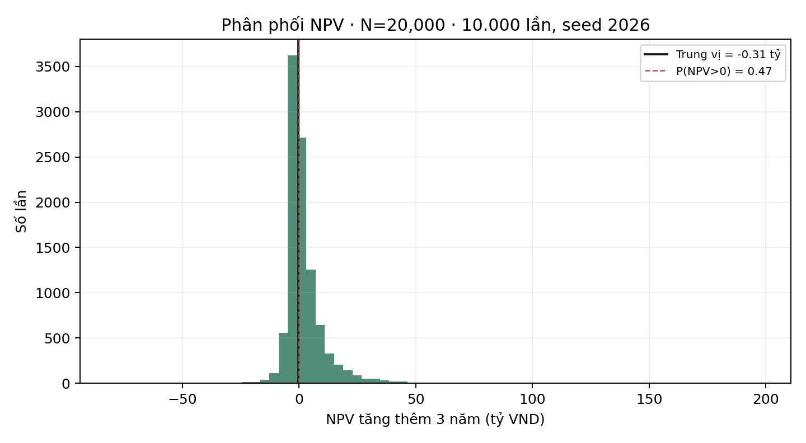
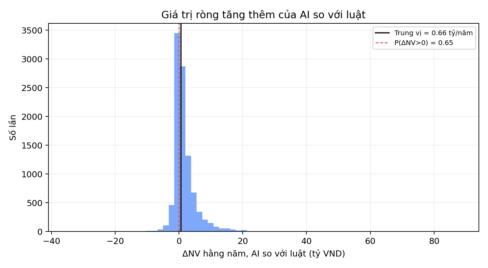
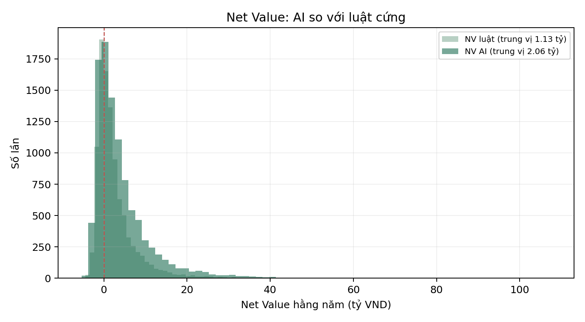
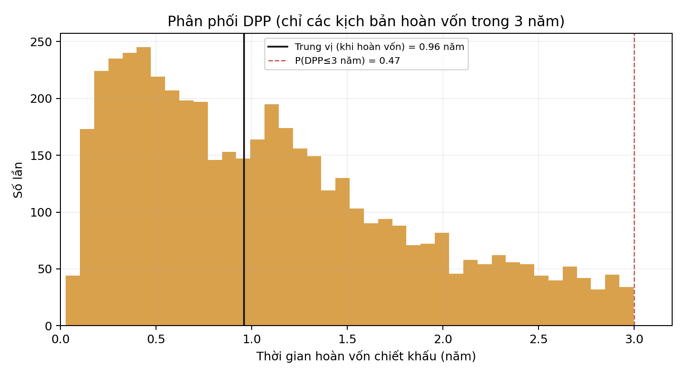
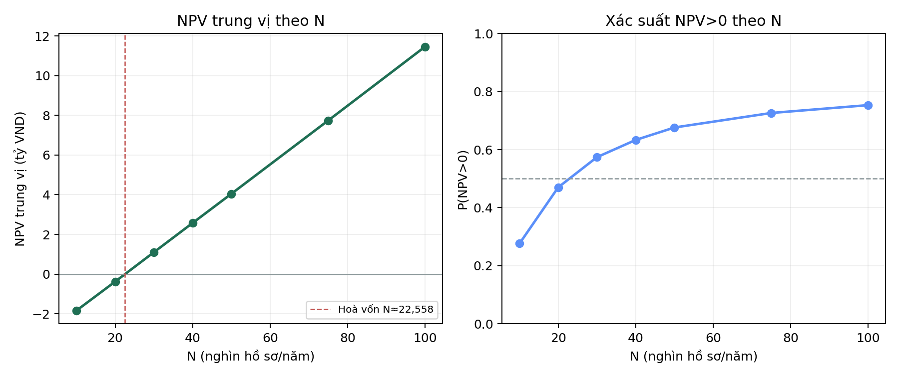

# Business Case & ROI — Monte Carlo (mô hình Thanh Vy)

**Người thực hiện:** Huy Nhật · **Ngày:** 22/10/2026 · **Mô phỏng:** 10.000 lần, seed 2026.
**Engine chuẩn:** `scripts/monte_carlo_business_case.py` (Thanh Vy). Runner biểu đồ/sensitivity: `scripts/run_business_case.py` → `reports/business_case/business_case_v2.json` + 4 biểu đồ.

> Toàn bộ tham số và công thức là **bản chính thức của Thanh Vy** (chạy trực tiếp script của bạn ấy). Huy Nhật bổ sung biểu đồ, phân tích độ nhạy theo N, điểm hoà vốn N, và báo cáo. Đây là so sánh **AI so với luật cứng** (dòng tiền tăng thêm), không phải AI so với không làm gì.

## 1. Tham số quyết định (cố định)

| Tham số | Giá trị |
|---|---|
| N (hồ sơ/năm, kênh từ xa) | 20.000 |
| K (hàng đợi xem kỹ) | 10% |
| K_SIU (chuyển SIU) | 1% tổng hồ sơ (9% còn lại yêu cầu bổ sung) |
| Chiết khấu r | 10%/năm, horizon 3 năm |
| Ramp năm 1 | 0,75 (3 tháng chạy song song) |

Tham số bất định (Beta/log-normal/uniform: p, Recall AI/luật, L̄, η, c_bs, c_SIU, c_CSKH, Δq, V_KH, chi phí AI/luật, C₀) lấy đúng bảng Thanh Vy; cặp Recall nối bằng Gaussian copula ρ=0,5.

## 2. Kết quả (N=20.000, 10.000 lần)

| Đại lượng | p5 | Trung vị | p95 |
|---|---:|---:|---:|
| p (tỷ lệ nhóm B) | 5,0% | 7,2% | 10,0% |
| Recall@10% thực — AI | 14,9% | **28,6%** | 51,5% |
| Recall@10% thực — luật | 10,0% | 18,9% | 35,4% |
| Precision AI | 0,098 | 0,206 | 0,393 |
| NV_AI hằng năm (tỷ) | −2,09 | 2,06 | 18,39 |
| NV_luật hằng năm (tỷ) | −1,86 | 1,13 | 12,19 |
| ΔNV hằng năm (tỷ) | −1,82 | **0,66** | 8,83 |
| **NPV tăng thêm 3 năm (tỷ)** | **−5,93** | **−0,31** | **18,10** |
| ROI tăng thêm | −1,62 | **−0,08** | 5,06 |
| DPP (năm, khi hoàn vốn) | — | 0,96 | — |

**Xác suất đạt tiêu chí:**
- P(NV_AI > 0) = **0,72** · P(ΔNV > 0) = **0,65**
- **P(NPV > 0) = 0,47** · P(DPP ≤ 3 năm) = 0,47
- P(Precision > Precision hoà vốn) = **0,72**

**Đọc thẳng:** ở N=20.000, dự án **chỉ ở ngưỡng hoà vốn** — NPV trung vị hơi âm (−0,31 tỷ), chỉ ~47% khả năng NPV dương, ROI trung vị ≈ −8%. AI xếp hạng tốt hơn luật (Recall 28,6% vs 18,9%, ΔNV trung vị +0,66 tỷ/năm) nhưng lợi ích tăng thêm **chưa đủ chắc** để vượt chi phí vận hành AI + đầu tư ban đầu ở quy mô này.







## 3. Thời gian hoàn vốn (DPP)

Khi dự án **có** hoàn vốn, thời gian hoàn vốn chiết khấu trung vị chỉ **~0,96 năm** (dòng tiền năm 1 đủ bù vốn đầu tư C₀). Nhưng đây là điều kiện: chỉ **47% kịch bản hoàn vốn trong vòng 3 năm** (P(DPP≤3 năm) = 0,47), phần còn lại không hoàn vốn trong horizon. Khi thắng thì thắng nhanh, nhưng xác suất thắng ở N=20.000 chỉ quanh ngưỡng 50/50 — khớp với NPV trung vị ≈ 0.



## 4. Precision hoà vốn (break-even)

Precision hoà vốn trung vị **Prec\* = 0,124**; Precision AI trung vị 0,206 > Prec\*, và **P(Precision AI > Prec\*) = 0,72**. Nghĩa là về mặt precision, hàng đợi AI vượt ngưỡng hoà vốn trong ~72% kịch bản — tín hiệu tích cực, nhưng NPV còn chịu thêm C₀ và chi phí cố định nên vẫn ở ngưỡng.

## 5. Độ nhạy theo N và điểm hoà vốn

| N (hồ sơ/năm) | 10k | 20k | 30k | 40k | 50k | 75k | 100k |
|---|---:|---:|---:|---:|---:|---:|---:|
| NPV trung vị (tỷ) | −1,84 | −0,38 | 1,10 | 2,58 | 4,05 | 7,74 | 11,46 |
| P(NPV > 0) | 0,28 | 0,47 | 0,57 | 0,63 | 0,68 | 0,73 | 0,75 |

**Điểm hoà vốn: N ≈ 22.600 hồ sơ/năm** (NPV trung vị vượt 0). Dưới mức này dự án lỗ kỳ vọng; trên mức này giá trị tăng gần tuyến tính theo quy mô (chi phí cố định AI được khai thác tốt hơn).



## 6. Kết luận và khuyến nghị

- Ở **N=20.000**, quyết định **chưa rõ ràng** (NPV ≈ 0, P(NPV>0) 47%). Không nên khẳng định có lãi.
- Dự án **chuyển có lợi khi quy mô ≥ ~22.600 hồ sơ/năm**; vì vậy nên **mở rộng kênh/định tuyến thêm hồ sơ qua hệ thống**, hoặc chạy **pilot** để (a) xác nhận N thực, (b) thu nhãn thật nâng Recall, (c) đo lại chi phí.
- AI vượt luật về xếp hạng và precision hoà vốn, nên giá trị gia tăng là có cơ sở; rào cản là **quy mô và chi phí cố định**, không phải chất lượng mô hình.

## 7. Giới hạn

1. Recall gốc từ 49 hồ sơ (Jeffreys), frozen test p=24,5%; tập nhỏ nên đuôi phân phối rộng.
2. Nhiều chi phí là khoảng uniform (ít thông tin); cần số kế toán thật để siết lại.
3. Là kịch bản có điều kiện trên giả định, chưa phải cam kết tài chính.

## 8. Tái lập

```bash
python scripts/monte_carlo_business_case.py --N 20000   # số chuẩn của Thanh Vy
python scripts/run_business_case.py                     # biểu đồ + sensitivity + report
```
