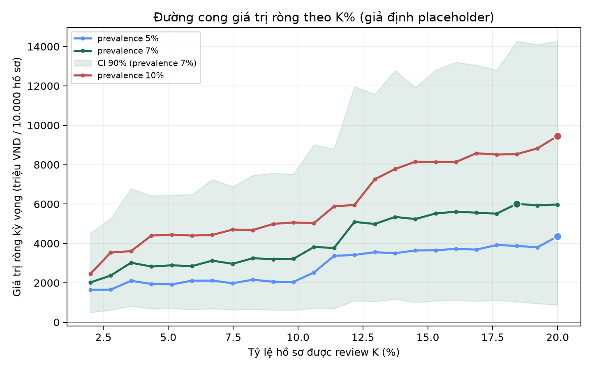
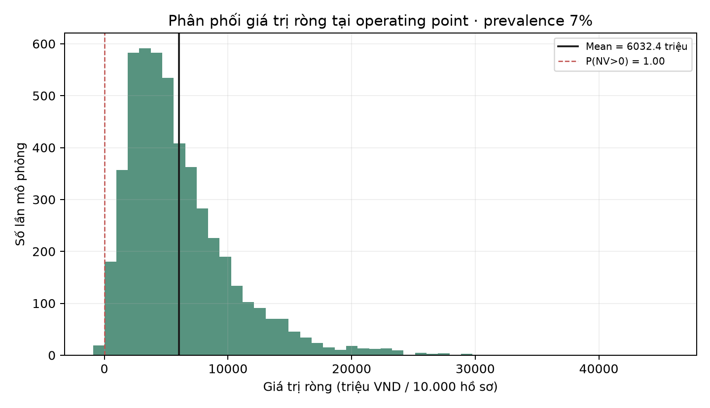

# Business Case & ROI — Monte Carlo và operating point (t1, t2)

> **CẢNH BÁO:** mọi con số VND dưới đây là **kịch bản dựa trên giả định placeholder** trong `configs/business_assumptions_montecarlo.v1.yaml`, **CHƯA phải chi phí thật đã kiểm chứng**. Phần "chốt giả định chi phí" do Thanh Vy sở hữu; khi có số thật, thay vào config và đổi `status` thành `confirmed` rồi chạy lại. Không dùng kết quả cho quyết định tài chính khi còn ở trạng thái placeholder.

**Sinh bởi:** `python scripts/run_roi_montecarlo.py` → `reports/business_case/roi_montecarlo.json` + 2 biểu đồ.
**Người thực hiện:** Huy Nhật · **Model chấm điểm:** B2 XGBoost trên `feature_selection_v1/val_fs`.

## 1. Phương pháp

- **Hai hàng đợi:** hồ sơ có điểm ≥ `t1` vào review thường; ≥ `t2` chuyển SIU. SIU điều tra sâu hơn nên chặn được tỷ lệ tổn thất cao hơn (effectiveness khác nhau) với chi phí cao hơn. Nhờ vậy `t1`, `t2` thật sự có đánh đổi.
- **Label shift:** tỷ lệ hồ sơ vào từng hàng đợi ở mỗi kịch bản prevalence tính từ phân phối điểm theo lớp đã cố định của val_fs (giả định phân phối điểm theo lớp không đổi).
- **Monte Carlo 5.000 lần:** mỗi vòng rút một bộ tham số chi phí từ phân phối khai báo (Beta / log-normal / uniform) → một giá trị giá trị ròng. Tổng hợp thành trung bình, trung vị, khoảng [p5; p95] và xác suất giá trị ròng dương.
- **Chọn operating point:** lưới `t1 ≤ t2` tối đa hóa giá trị ròng kỳ vọng dưới ràng buộc **K1 ≤ 20%** (trần tỷ lệ review) và **K2 ≤ 5%** (trần tỷ lệ SIU).
- **Quy mô:** danh mục 10.000 hồ sơ. Đơn vị: triệu VND.

## 2. Giả định đầu vào (placeholder)

| Tham số | Phân phối | Tham số phân phối |
|---|---|---|
| fraud_loss_avoided | log-normal | median 30.000.000 VND, σ 0,5 |
| prevention_effectiveness_manual | Beta | α5 β5 (kỳ vọng 0,50) |
| prevention_effectiveness_siu | Beta | α7,5 β2,5 (kỳ vọng 0,75) |
| review_cost | log-normal | median 250.000 VND, σ 0,4 |
| siu_cost | log-normal | median 2.500.000 VND, σ 0,4 |
| false_hold_cost | uniform | 200.000–800.000 VND |
| ai_operation_cost_per_claim | uniform | 2.000–8.000 VND |

## 3. Operating point theo kịch bản prevalence

Giá trị ròng tính trên **10.000 hồ sơ**.

| Prevalence | t1 | t2 | % review | % SIU | Recall hàng đợi | GTR trung vị (triệu) | GTR TB (triệu) | P(GTR>0) |
|---|---:|---:|---:|---:|---:|---:|---:|---:|
| 5% | 0,426 | 0,772 | 19,4% | 0,6% | 62,9% | 3.482 | 4.301 | 0,98 |
| **7%** | **0,498** | **0,772** | **18,2%** | **0,8%** | **57,1%** | **4.964** | **6.032** | **1,00** |
| 10% | 0,498 | 0,689 | 19,4% | 4,0% | 57,1% | 7.776 | 9.338 | 0,99 |

Nhận xét: prevalence càng cao thì giá trị ròng càng lớn (nhiều gian lận để chặn) và SIU được dùng nhiều hơn (ở 10% SIU chạm gần trần K2). Mọi operating point đều tôn trọng K1 ≤ 20% và K2 ≤ 5%.

## 4. Phân phối giá trị ròng (kịch bản nền 7%)

Trung vị 4.964 triệu, trung bình 6.032 triệu, khoảng [p5; p95] = [1.126; 14.381] triệu VND / 10.000 hồ sơ, P(GTR>0) = 0,996. Khoảng rất rộng vì tổn thất tránh được (log-normal) và effectiveness (Beta) có độ bất định lớn — đúng tinh thần Monte Carlo: kết luận là phân phối, không phải một con số.





## 5. Giới hạn

1. **Giả định placeholder:** chưa phải chi phí thật; chờ Thanh Vy chốt số có nguồn.
2. **val_fs chỉ 140 hồ sơ (35 Y):** phân phối điểm theo lớp thô, operating point sẽ đổi khi có tập đúng miền lớn hơn.
3. **Label shift:** prevalence 5/7/10% là mô phỏng dịch nhãn, giả định phân phối điểm theo lớp không đổi; chưa phải prevalence production đã xác minh.
4. **Chưa phải final test:** dùng B2 development; cần external claim-linked test sau khi khóa mô hình, ngưỡng.
5. Điểm chỉ ưu tiên hồ sơ cho người duyệt; không tự kết luận gian lận hay tự từ chối bồi thường.

## 6. Tái lập

Sửa `configs/business_assumptions_montecarlo.v1.yaml` (thay số thật, đổi `status`) rồi chạy:

```bash
python scripts/run_roi_montecarlo.py
```
