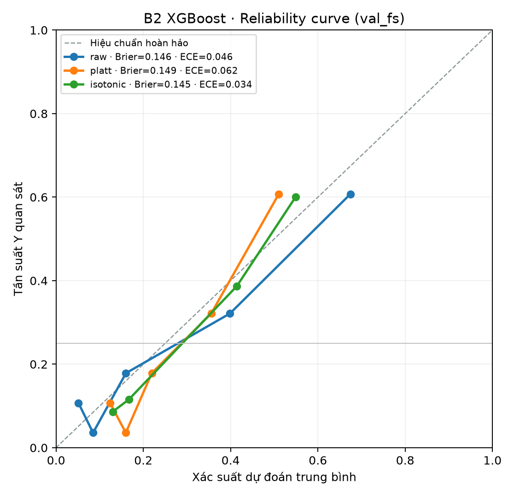

# B2 (XGBoost) — Calibration trên val_fs

**Split:** `feature_selection_v1/val_fs` · 140 hồ sơ, 35 Y (prevalence 25%).
**Sinh bởi:** `python scripts/evaluate_b2_calibration.py` → `reports/phase5/b2_calibration.json` + `reports/phase5/b2_reliability.png`.

AP và thứ tự hàng đợi chỉ đo *xếp hạng*, không cho biết điểm có đọc được như *xác suất* hay không. Hiệu chuẩn là phép biến đổi đơn điệu nên **không đổi AP cũng không đổi thứ tự hàng đợi**; chỉ phần đọc xác suất thay đổi.

## Kết quả

| Biến thể | Brier ↓ | ECE (10 bin) ↓ | AP | Ghi chú |
|---|---:|---:|---:|---|
| Raw XGBoost | 0,1464 | 0,0459 | 0,5978 | Điểm gốc, chưa hiệu chuẩn |
| Platt (sigmoid) | 0,1488 | 0,0617 | 0,5978 | Không cải thiện trên tập này |
| Isotonic | 0,1452 | 0,0338 | **0,5346** | ECE tốt hơn nhưng **tụt AP** |

Hai calibrator được fit **chỉ trên out-of-fold của train** (5-fold `cross_val_predict`), không bao giờ fit trên val_fs.

## Đọc kết quả

- **Raw XGBoost đã khá chuẩn** (ECE ≈ 0,046): mức lệch xác suất không lớn.
- **Platt làm xấu đi** nhẹ trên tập nhỏ này.
- **Isotonic giảm ECE** (0,034) nhưng **làm tụt AP từ 0,598 xuống 0,535**: trên 140 dòng, isotonic gộp nhiều giá trị thành bậc thang phẳng, tạo đồng hạng và phá vỡ thứ tự xếp hàng. Không nên áp dụng isotonic ở quy mô này.

## Khuyến nghị

1. **Chưa gắn calibrator nào vào B2 cho hàng đợi.** Raw đủ tốt cho mục tiêu xếp hạng; isotonic đánh đổi AP không đáng.
2. Chỉ công bố "xác suất đã hiệu chuẩn" sau khi có **tập đúng miền lớn hơn** (≥ vài trăm Y). Với 35 Y, mọi số calibration đều nhiễu, đọc như chỉ dấu.
3. Khi có dữ liệu đủ: fit lại Platt/Isotonic trên OOF train, chọn theo Brier/ECE **đồng thời kiểm AP không tụt**, rồi mới promote.

